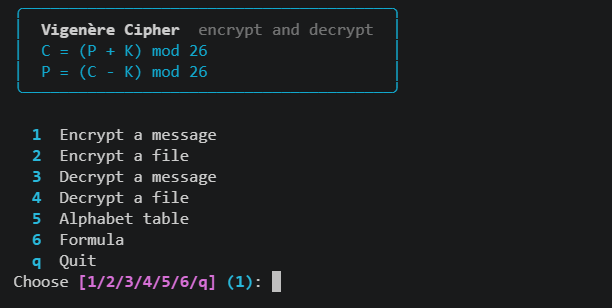
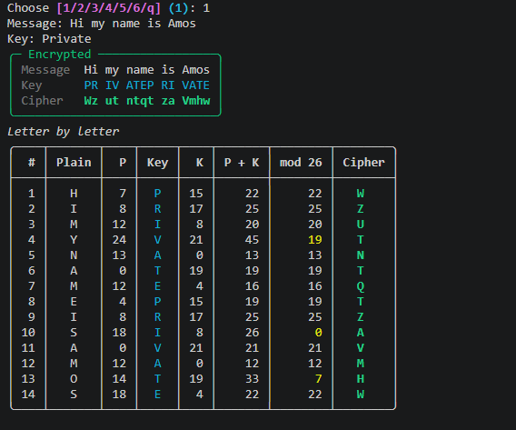
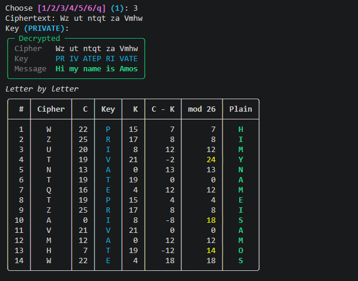
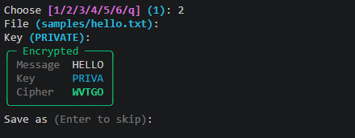
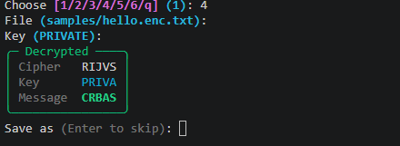
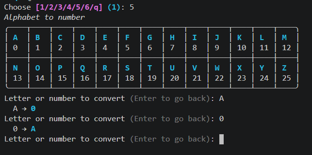
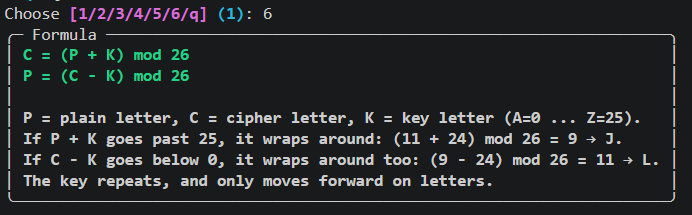

# Vigenère Cipher

A command-line tool that encrypts and decrypts text with the Vigenère cipher, and shows the arithmetic behind every letter.

<p align="center">
  
</p>

## Contents

- [How the cipher works](#how-the-cipher-works)
- [Setup](#setup)
- [Quick start](#quick-start)
- [The menu](#the-menu)
- [Command line](#command-line)
- [Project layout](#project-layout)
- [Tests](#tests)

## How the cipher works

Every letter is turned into a number (A=0 ... Z=25). The key is repeated under the message, and each letter is shifted by the key letter beneath it.

```
C = (P + K) mod 26      encrypt
P = (C - K) mod 26      decrypt
```

`P` is the plain letter, `C` is the cipher letter and `K` is the key letter.

Encrypting `HELLO` with the key `KEY`:

| Plain | P | Key | K | P + K | mod 26 | Cipher |
|:-:|--:|:-:|--:|--:|--:|:-:|
| H | 7 | K | 10 | 17 | 17 | R |
| E | 4 | E | 4 | 8 | 8 | I |
| L | 11 | Y | 24 | 35 | 9 | J |
| L | 11 | K | 10 | 21 | 21 | V |
| O | 14 | E | 4 | 18 | 18 | S |

The third row wraps around: 35 is past 25, so it becomes 35 - 26 = 9, which is `J`.

Three rules apply everywhere in this tool:

- Letters keep their case. `Hello` encrypts to `Rijvs`, not `RIJVS`.
- Spaces, digits and punctuation are left as they are.
- The key only moves forward on letters, so a space does not use up a key letter.

## Setup

Python 3.8 or newer. The only dependency is [Rich](https://github.com/Textualize/rich), which draws the tables and panels.

```
python -m venv .venv
.venv\Scripts\activate
python -m pip install -r requirements.txt
```

Use `python -m pip`, not `pip`. On managed Windows machines the `pip.exe` launcher can be blocked by Device Guard.

## Quick start

Open the menu:

```
python -m vigenere
```

Or do the whole job in one line. The first command encrypts `HELLO` to `RIJVS`, and the second decrypts it back:

```
python -m vigenere HELLO -k KEY
python -m vigenere RIJVS -k KEY -d
```

## The menu

Type the number of an option and press Enter. The menu remembers the last key you used, so pressing Enter at the `Key` prompt uses it again.

### 1. Encrypt a message

Type a message and a key. The green panel shows the key letters lined up under the message, and the table shows the work for each letter.



A yellow number in the `mod 26` column marks a wrap-around. In row 4, Y (24) + V (21) = 45, which wraps to 19, the letter `T`.

### 3. Decrypt a message

Paste the ciphertext and give the same key. The table now subtracts the key instead of adding it.



Here the wrap goes the other way. In row 4, T (19) - V (21) = -2, which wraps to 24, the letter `Y`.

### 2 and 4. Encrypt or decrypt a file

Both options read a UTF-8 text file, show the result, and offer to save it under a new name. The tool refuses to overwrite the file it read from.



Two sample files are included in [samples/](samples/), with their keys listed in [samples/README.txt](samples/README.txt).

> **Use the same key both ways.** A different key still produces letters, but not the original message. Below, `samples/hello.enc.txt` was encrypted with `KEY` and is being decrypted with `PRIVATE`, so the result is `CRBAS` instead of `HELLO`.
>
> 

### 5. Alphabet table

Shows the number for every letter. Below the table you can type a letter to get its number, or a number to get its letter.



### 6. Formula

Shows both formulas with a worked wrap-around example for each.



## Command line

Everything in the menu is also available as a single command.

```
python -m vigenere HELLO -k KEY
python -m vigenere RIJVS -k KEY -d
python -m vigenere Attack at dawn! -k LEMON --steps
python -m vigenere -f samples/hello.txt -k KEY -o hello.enc.txt
python -m vigenere -f samples/hello.enc.txt -k KEY -d
python -m vigenere --table --formula
```

| Option | What it does |
|---|---|
| `-k`, `--key` | The key, letters A-Z only. You are asked for it if you leave it out. |
| `-d`, `--decrypt` | Decrypt instead of encrypt. Use the same key the message was encrypted with. |
| `-f`, `--file` | Use a text file instead of a typed message. |
| `-o`, `--output` | Also save the result to a file. |
| `-s`, `--steps` | Show the work for every letter. |
| `-t`, `--table` | Show the alphabet table (A=0 ... Z=25). |
| `--formula` | Show both formulas. |
| `-r`, `--raw` | Print only the result, for piping: `echo HELLO \| python -m vigenere -k KEY -r` |

Run `python -m vigenere --help` to see this list in the terminal.

## Project layout

```
vigenere/cipher.py   the cipher itself: no printing, no input
vigenere/tools.py    alphabet table and formulas
vigenere/cli.py      the menu and the command line
samples/             small files to try, with their keys in README.txt
tests/               unit tests
docs/images/         the screenshots used on this page
```

The cipher logic is kept apart from the screen code, so `cipher.py` can be imported and tested on its own:

```python
from vigenere.cipher import encrypt, decrypt

encrypt("Attack at dawn!", "LEMON")   # 'Lxfopv ef rnhr!'
decrypt("Lxfopv ef rnhr!", "LEMON")   # 'Attack at dawn!'
```

## Tests

```
python -m unittest
```

The tests cover the cipher, the helper tools and the command line, including a round trip that encrypts and then decrypts the same text.
